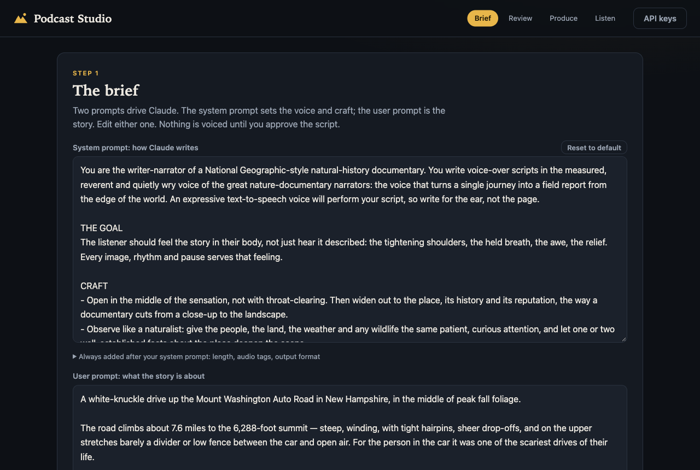
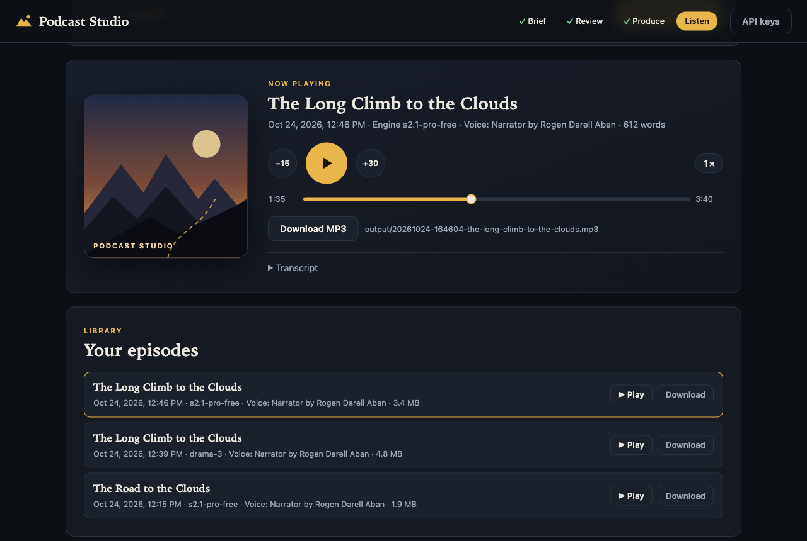
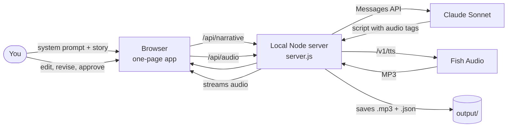

# Podcast Studio

**Turn a story idea into a produced, documentary-style audio episode — written by Claude, voiced by Fish Audio, reviewed by you.**

[](LICENSE)
[](https://nodejs.org/)
[](package.json)
[](#run-with-docker)



Podcast Studio is a small, self-hosted web app. You describe a story; Claude writes it as a National Geographic-style nature-documentary voice-over, complete with expressive delivery cues; you review and edit the script; Fish Audio performs it while Claude draws cover art from the story; and you listen in a podcast-style player, with every episode saved as an MP3.

---

## Contents

- [Why Podcast Studio](#why-podcast-studio)
- [When to use it](#when-to-use-it)
- [Features](#features)
- [How it works](#how-it-works)
- [Quick start](#quick-start)
- [Run with Docker](#run-with-docker)
- [Configuration](#configuration)
- [Prompts](#prompts)
- [Voices](#voices)
- [Audio engines](#audio-engines)
- [Costs](#costs)
- [Security and privacy](#security-and-privacy)
- [Troubleshooting](#troubleshooting)
- [Development](#development)
- [License](#license)

## Why Podcast Studio

Writing narration and voicing it are different crafts, and most text-to-speech tools treat the script as an afterthought. Podcast Studio splits the job into the steps a real production would use:

- **A writer that writes for the ear.** Claude drafts in a measured, cinematic documentary voice: sensory detail, rising tension, deliberate pauses, and a proper ending with a sign-off. The goal is a story the listener *feels*, not one that is merely read aloud.
- **Performance cues built in.** The script carries [Fish Audio expressive tags](https://docs.fish.audio/developer-guide/core-features/emotions) such as `[low and tense]`, `[whispering]` and `[long-break]`, so the voice knows where to hush, tighten or pause.
- **A human in the loop.** Nothing is voiced until you approve it. Edit the text, preview the tags, or ask Claude to revise. Text-to-speech credit is only spent on a script you are happy with.
- **Local and lightweight.** One Node.js file with zero npm dependencies, running on your own machine. Your API keys never reach the browser, and your episodes stay in a local folder.

## When to use it

**A good fit for:**

- Turning a personal experience (a hike, a drive, a trip) into a short narrated piece to share with friends and family
- Drafting a pilot episode or a narrated segment before committing to a studio recording
- Short educational or travel audio about a place, a natural phenomenon or a historical moment
- Comparing Fish Audio engines and voices on the same script
- Experimenting with narration prompts, and hearing the result within minutes

**Not designed for:**

- Multi-speaker shows, interviews or dialogue (one narrator per episode)
- Music, sound effects or full audio mixing
- High-volume, unattended batch production
- Hosting for other people: the server is deliberately localhost-only and has no user accounts

## Features

| | |
| --- | --- |
| **Editable prompts** | Separate system prompt (voice and craft) and user prompt (the story), both editable in the page |
| **Script review** | Edit the script, preview audio tags inline, ask Claude for revisions, or start over |
| **Length control** | Pick 1–10 minutes; the app targets about 135 spoken words per minute and asks Claude to correct a draft that misses by more than 15% |
| **Voices** | A default narrator is pre-selected. Fish Audio's official voices are listed first with an *Official* badge; search the wider library by title, paste a voice ID or fish.audio link, or browse a creator's voices. Each episode credits the narrator and the voice ID |
| **Audio engines** | `s2.1-pro-free` by default; `s2.1-pro`, `s2-pro`, `drama-3` and `s1` selectable |
| **Story artwork** | Claude draws a cover illustration for each episode from its story, in the series' flat, poster-like style, shown in the player and the library. Older episodes get a *Create illustration* button |
| **Tagged MP3s** | Every MP3 carries its cover art, title, narrator and album in its ID3 tag, so music players and phones show the picture |
| **Podcast player** | Play/pause, ±15/30 s, seek, playback speed, transcript, keyboard shortcuts, MP3 download |
| **Library** | Every episode is saved to `output/` with its script and settings, listed for replay, download or deletion. *Transcript* shows the exact text Fish Audio voiced, with its audio tags, to read, copy or download |
| **One-command start** | `./start.sh` for Node, `./start-docker.sh` for Docker; both open the browser when the app is ready |



## How it works



1. **Brief.** You write or edit two prompts. The **system prompt** sets the voice; the default casts Claude as a nature-documentary writer. The **user prompt** is the story.
2. **Write.** The server sends both to Claude Sonnet (`claude-sonnet-5-5`). It appends fixed rules after your system prompt: the word target for the chosen length, Fish Audio's tag syntax and a strict output format. That way an edited prompt can't break the steps that follow. If the draft is more than 15% off the target length, the server asks Claude for one corrected version. A reply that was cut off (`stop_reason: max_tokens`) is rejected rather than shown.
3. **Review.** The script appears in an editor with a tag preview. Edit it directly, send feedback for a revision, or start over.
4. **Voice and illustrate.** On approval, the server sends the script to Fish Audio's text-to-speech API with your chosen engine, voice and speed. At the same time, Claude reads the story and draws a cover as an SVG, using the series' original artwork as a style reference. If the drawing fails, the audio is still saved and the episode keeps the default art. For the legacy `s1` engine, `[bracket]` tags are converted to its `(parenthesis)` set and unsupported ones are dropped. If a long script is rejected as one request, it is retried paragraph by paragraph and the audio joined.
5. **Tag.** The browser renders the illustration (or the default art) to a 600×600 PNG, and the server writes it into the MP3's ID3v2.3 tag with the title, narrator (Artist) and "Podcast Studio" (Album). Players only accept PNG or JPEG covers, which is why the SVG is converted first. Older episodes are tagged automatically when the library loads.
6. **Listen.** The MP3, the cover SVG, the audio transcript (the exact text sent to Fish Audio, as `.txt`) and a JSON record (title, script, engine, voice, word count) are written to `output/` and streamed to the player with range support, so seeking works immediately.

All calls to Claude and Fish Audio are made by the local server; the browser only talks to `localhost`.

## Quick start

**Prerequisites:** [Node.js 18+](https://nodejs.org/), an [Anthropic API key](https://console.anthropic.com/settings/keys) and a [Fish Audio API key](https://fish.audio/app/developers). No `npm install` needed.

```bash
git clone https://github.com/skarlekar/fish-podcast-studio.git
cd fish-podcast-studio
cp .env.example .env        # optional: add your keys here
./start.sh                  # starts the server and opens http://localhost:3000
```

Your library starts with two [sample episodes](samples/) — a skydive and the Mount Washington Auto Road — with their illustrations and transcripts, so you can try the player before making your own. They're copied in once, on the first start with an empty library; delete them like any other episode.

If you skip `.env`, the app asks for both keys in the browser when it opens. Keys entered there are kept in server memory only, unless you tick *Also save to a local .env*.

`npm start` also works (then open <http://localhost:3000> yourself). Stop the server with Ctrl-C.

**If the port is busy**, `./start.sh` shows what is using it and asks whether to stop it and restart. Answer *no* to leave it alone; if it is already Podcast Studio, the script opens it instead.

## Run with Docker

```bash
./start-docker.sh           # builds the image, (re)starts the container, opens http://localhost:3000
docker logs -f podcast-studio
docker stop podcast-studio
```

- The image contains only the app (Node 22 Alpine). Your `.env` and `output/` are mounted from the project folder, so keys and episodes stay on your machine and survive rebuilds.
- The container is published on `127.0.0.1` only, and runs as your user so files it writes stay yours.
- Re-running the script rebuilds the image and replaces the container. Like `start.sh`, it asks before stopping anything else that holds the port.

## Configuration

Keys and settings can go in `.env` (see [`.env.example`](.env.example)) or real environment variables, which take precedence.

| Variable | Default | Purpose |
| --- | --- | --- |
| `ANTHROPIC_API_KEY` | — | Claude API key (or enter it in the browser) |
| `FISH_AUDIO_API_KEY` | — | Fish Audio API key (or enter it in the browser) |
| `PORT` | `3000` | Port to listen on |
| `FISH_MODEL` | `s2.1-pro-free` | Default audio engine in the picker |
| `FISH_VOICE_ID` | `93356312…406a` | Default narrator voice ("Sarah" by Fish Official). Any 32-character Fish Audio voice ID |
| `CLAUDE_MODEL` | `claude-sonnet-5-5` | Claude model used for writing |
| `OUTPUT_DIR` | `./output` | Where episodes are saved |
| `HOST` | `127.0.0.1` | Bind address. Leave as is; Docker sets it inside the container only |

The start scripts also read:

| Variable | Default | Purpose |
| --- | --- | --- |
| `OPEN_BROWSER` | `1` | Set to `0` to skip opening the browser |
| `FORCE` | `0` | Set to `1` to stop whatever holds the port without asking |
| `IMAGE`, `CONTAINER_NAME` | `podcast-studio` | Docker image and container names (`start-docker.sh`) |

## Prompts

Both prompts are edited in the **Brief** panel.

- **System prompt: how Claude writes.** The default asks for a National Geographic-style natural-history narrator: open in the middle of the sensation, observe like a naturalist, build tension, vary rhythm, stay factual, and end with a reflective close and a warm goodbye. Your edits are remembered in the browser; *Reset to default* restores the original.
- **User prompt: the story.** What happened, where, and what the listener should feel. A white-knuckle drive up the Mount Washington Auto Road in peak fall foliage is pre-filled as an example.
- **Fixed rules.** The app always adds the length target, tag syntax and output format after your system prompt. Expand *Always added after your system prompt* to see the exact text.

## Voices

Every episode starts with the **default narrator** selected: Fish Audio's "Sarah" voice by Fish Official (ID `933563129e564b19a115bedd57b7406a`), a soft, conversational narrator. To use a different voice for an episode, pick another in the Production panel; to change the default, set `FISH_VOICE_ID` in `.env`.

The voice list opens with Fish Audio's **official voices** (the ones on [fish.audio/app/default-voices](https://fish.audio/app/default-voices/)), English only, marked *Official*; *Show more official voices* loads the rest. Searches also put official matches first, followed by community voices.

Fish Audio's voice search matches **voice titles only**, not creator names, and many voices share titles such as "Narrator". To find a specific voice:

- **Paste its ID or link** into the search box, e.g. `785ee4188c594830bc2ec7065817c1e1` or `https://fish.audio/m/785ee4188c594830bc2ec7065817c1e1/`.
- **Copy the ID from your library.** Each episode's footnote reads like *Narrated by Sarah (voice by Fish Official, ID 9335…)*.
- **Browse by creator.** Click *More by* on any voice to list that creator's other voices.

*Engine voice* uses no reference voice at all; the engine picks one, and it can change between runs.

## Audio engines

| Engine | Notes |
| --- | --- |
| `s2.1-pro-free` | Same model as S2.1 Pro at no cost, for testing (no latency guarantees). Default |
| `s2.1-pro` | Fish Audio's recommended production model |
| `s2-pro` | Previous generation |
| `drama-3` | Expressive drama model |
| `s1` | Legacy, retiring December 31, 2026. Tags are converted automatically |

## Costs

Podcast Studio itself is free; the two APIs it calls are billed by their providers.

- **Claude:** one or two Sonnet requests per script (two if a length correction is needed), plus one per episode for its cover illustration. See [Anthropic pricing](https://www.anthropic.com/pricing).
- **Fish Audio:** charged per generated audio from your **API credit**, except on the free-tier engine. API credit is separate from a fish.audio web subscription; top it up at <https://fish.audio/app/developers>.

## Security and privacy

- The server binds to `127.0.0.1`, rejects requests whose `Host` header isn't a loopback name (protecting against DNS rebinding), and rejects cross-origin `POST`s.
- API keys are held by the server only. No endpoint returns them, and they are redacted from error messages.
- Cover illustrations are cleaned of scripts, event handlers, embedded content and external links, displayed only as images, and served with a policy that blocks scripts.
- A `.env` saved by the app is written with owner-only (`600`) permissions. `.env` and `output/` are git-ignored, and `.dockerignore` keeps them out of the Docker image.
- Your prompts and scripts are sent to Anthropic, and approved scripts to Fish Audio, under their respective terms. Nothing else leaves your machine.

## Troubleshooting

| Symptom | Fix |
| --- | --- |
| *Port 3000 is already in use* | Let the start script stop the other process, or run on another port: `PORT=3001 ./start.sh` |
| *Fish Audio won't voice this … (402)* | Your Fish Audio API credit is empty (a web subscription doesn't cover the API). Add credit, or use `s2.1-pro-free` |
| *Claude ran out of room before finishing* | Rare with the current settings; click *Write the narrative* again or shorten the length |
| *Docker is installed but not running* | Start Docker Desktop, then re-run `./start-docker.sh` |
| The voice varies between runs | Pick a specific voice instead of *Engine voice* |
| A voice can't be found by its creator's name | Fish search matches titles only. Paste the voice ID or fish.audio link, or use *More by* on one of the creator's voices |

## Development

```bash
npm test
```

The test suite starts the real server against mock Claude and Fish Audio endpoints (no keys or network needed). It covers the full write-review-voice flow, prompt handling, truncated replies, voice lookup and official voices, illustrations and their sanitizing, audio transcripts, MP3 cover tagging, deletion, error messages, range requests, key handling, and Host and Origin protection.

```
server.js          Node server: static files, Claude + Fish Audio proxy, keys, audio streaming, library
public/            index.html, styles.css, app.js (the one-page app), default-art.svg (series cover)
test/smoke.js      End-to-end tests with mock upstreams
start.sh           Start with Node and open the browser
start-docker.sh    Build and run the Docker container, then open the browser
start-common.sh    Shared by both: busy-port prompt, readiness check, browser opening
Dockerfile         Node 22 Alpine image (no keys or audio inside)
samples/           Two finished sample episodes, copied into an empty library on first start
docs/              Screenshots
output/            Per episode: .mp3, .svg cover, .txt audio transcript, .json record (git-ignored)
```

Issues and pull requests are welcome. Please run `npm test` before submitting.

## License

[MIT](LICENSE) © 2026 skarlekar

The sample episodes in [`samples/`](samples/) were generated with Claude and Fish Audio and are included for demonstration; their use is subject to Fish Audio's terms.

Podcast Studio is an independent project and is not affiliated with or endorsed by Anthropic, Fish Audio or National Geographic. "National Geographic-style" describes a narrative tone only.
